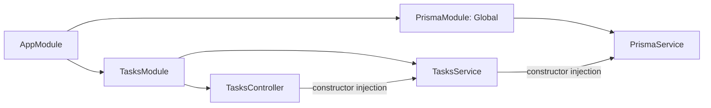

# Minh chứng DI và vòng đời request của đồ án

Nền hiện tại: NestJS 12.1.2, Express 5.2.1. Giữ nguyên phiên bản theo yêu cầu của nhóm.

## 1. Module và Dependency Injection

`AppModule` nhập các feature module; mỗi module đăng ký controller/service của mình. `PrismaModule` là module dùng chung, đăng ký và export `PrismaService`, được đánh dấu `@Global()`. `TasksController` nhận `TasksService` qua constructor; `TasksService` nhận `PrismaService`. `AuthModule` nhập `UsersModule` và cấu hình `JwtModule.registerAsync()` với `ConfigService`.



Nest tạo provider và giải quyết dependency dựa trên đăng ký module. Tự `new TasksService(...)` trong controller sẽ bỏ qua cách quản lý đó và khiến controller tự chịu trách nhiệm tạo dependency. Việc `new` một service với mock trong unit test là cách cô lập test, khác với cách khởi tạo trong ứng dụng.

Provider của đồ án dùng scope mặc định (singleton); không lưu user hiện tại vào thuộc tính dùng chung mà truyền `userId` theo từng lời gọi. Request scope chỉ nên dùng khi thực sự cần instance riêng cho mỗi request. Đồ án chưa sử dụng request scope. Căn cứ cơ chế: [NestJS Injection scopes](https://docs.nestjs.com/fundamentals/injection-scopes).

**Minh chứng chạy thật:** test `resolves the same default-scope services across two request contexts` dùng container của `AppModule`, resolve `TasksService` và `PrismaService` với hai `ContextId` khác nhau, xác nhận cùng instance. Kết quả lưu tại [request-lifecycle.json](evidence/request-lifecycle.json), trường `dependencyInjection`.

## 2. Luồng thành công: GET /tasks?page=1&limit=2

```mermaid
sequenceDiagram
  participant C as Client
  participant M as RequestIdMiddleware
  participant G as JwtAuthGuard
  participant I as RequestTimingInterceptor
  participant P as ValidationPipe
  participant H as TasksController
  participant S as TasksService
  participant D as Prisma / PostgreSQL
  C->>M: GET /tasks + Bearer token
  M->>G: Gắn requestId và startedAt
  G->>I: Token hợp lệ; gắn request.user
  I->>P: Trước handler
  P->>H: Chuyển page/limit sang number; kiểm tra DTO
  Note over H: @CurrentUser() lấy user đã xác thực
  H->>S: findAll(user.sub, query)
  S->>D: findMany và count có điều kiện userId
  D-->>S: Dữ liệu + tổng số bản ghi
  S-->>H: data và meta
  H-->>I: Kết quả handler
  I-->>C: Ghi log có durationMs; trả JSON 200
```

Trace thực tế kiểm tra trong test:

```text
middleware → guard → interceptor.before → pipe → handler → service → orm.findMany → interceptor.after
```

Service cũng gọi `count` để lấy tổng số bản ghi. Trace chọn `findMany` làm mốc chứng minh truy cập ORM, không có nghĩa đây là truy vấn duy nhất.

## 3. Hai nhánh dừng sớm

| Tình huống | Thứ tự được ghi nhận | Kết quả |
| --- | --- | --- |
| Thiếu token | middleware → guard → filter | 401; không chạy interceptor, pipe, handler hay service |
| Token hợp lệ nhưng limit=0 | middleware → guard → interceptor.before → pipe → filter | 400; không chạy handler/service/ORM, không có nhánh interceptor thành công |

Filter là nhánh xử lý exception chưa được bắt; không phải bước bắt buộc sau mọi response thành công. Guard quyết định request có được đi tiếp hay không; interceptor bao quanh phần xử lý phía sau để thực hiện xử lý xuyên suốt. Căn cứ thứ tự: [NestJS Request lifecycle](https://docs.nestjs.com/faq/request-lifecycle).

## 4. Cách thu minh chứng

`backend/test/request-lifecycle.e2e-spec.ts` dùng module và endpoint thật. Các spy ghi nhận điểm đi qua, sau đó chuyển tiếp tới implementation gốc với đúng `this`; metadata của method có decorator được giữ nguyên. Test không thay service/Prisma bằng dữ liệu giả và không thêm route demo vào sản phẩm. Sau test, tài khoản test được xóa và spy được khôi phục.

Chạy từ thư mục gốc:

```powershell
node scripts/verify-coverage.mjs
```

Mở [request-lifecycle.json](evidence/request-lifecycle.json) và [e2e.json](evidence/e2e.json). Chỉ dùng bản có `passed: true`/test thành công làm minh chứng. Request ID được chứng minh riêng tại [request-id.json](evidence/request-id.json): đối chiếu header, body lỗi, log và thời gian xử lý.
